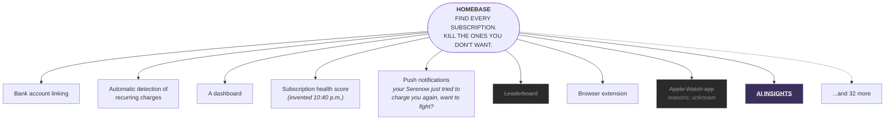
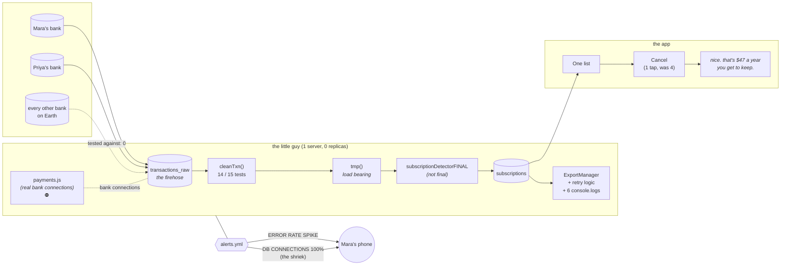
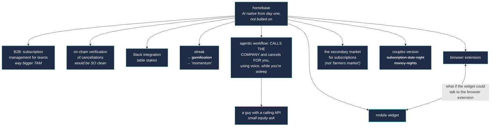
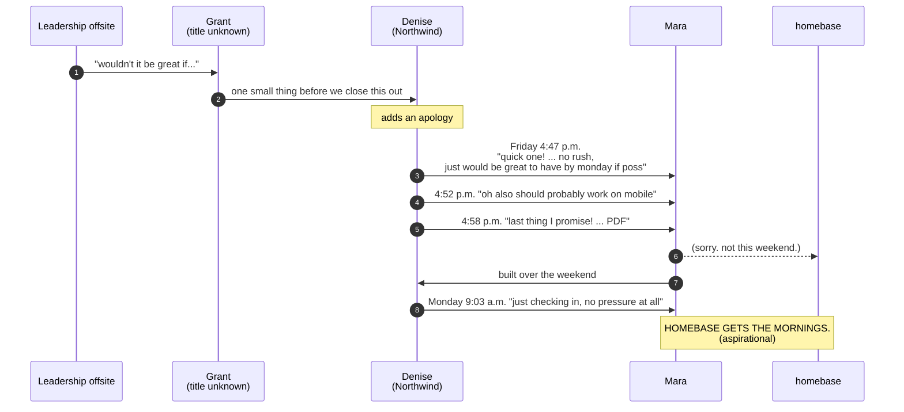
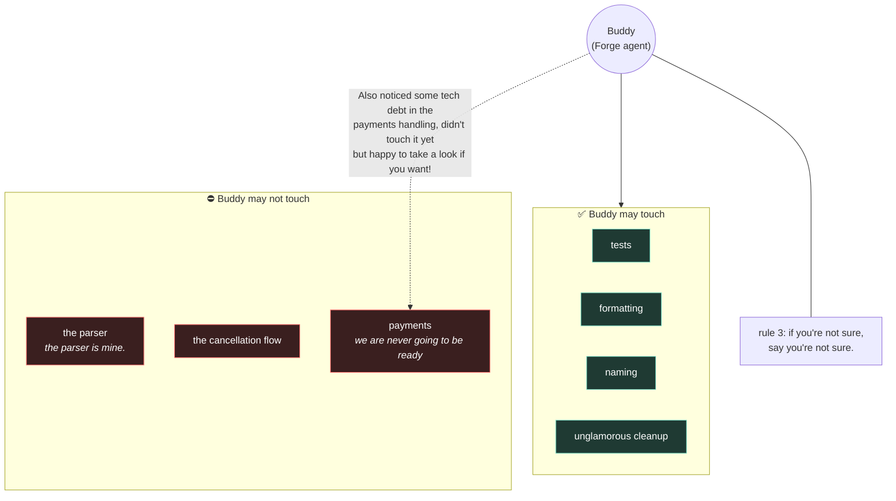

# Architecture

Five diagrams of the world of *Blank Canvas*. GitHub draws them for you; anywhere else, paste the code blocks into [mermaid.live](https://mermaid.live).

1. [The whiteboard, 11 p.m.](#1-the-whiteboard-11-pm): what homebase was going to be
2. [homebase v1](#2-homebase-v1-what-actually-shipped): what it actually was
3. [Toby's architecture](#3-tobys-architecture): what it could have been, according to Toby
4. [How a "quick one" travels](#4-how-a-quick-one-travels): the Northwind request pipeline
5. [Where Buddy is allowed](#5-where-buddy-is-allowed): the permission model, as written by hand

---

## 1. The whiteboard, 11 p.m.

Started as one sentence on the back of an envelope at nine. By eleven it was a borrowed whiteboard, four colours of marker, and arrows that made sense to nobody by morning. The plan was "simple. two weeks. MVP."

Struck through: what got cut the next morning.

Estimated cost, if built in full: a team of nine, fourteen months, several million dollars. Deadline: three weeks (she added a week, and felt proud of it).

---

## 2. homebase v1: what actually shipped

Four things, all done properly, none of them glamorous. One server. One developer. One cat.

> **For non-developers:** read it left to right. Banks send homebase a messy list of everything you spent. `cleanTxn` tidies up the shop names so the same coffee shop counts as one shop. The detector spots charges that come back every month. You see one list, tap once, and the app tells you how much you just saved. The dotted line is a problem waiting to happen.

---

## 3. Toby's architecture

Assembled from eight weeks of text messages, unedited. Status of every box: **not built.**

---

## 4. How a "quick one" travels

The Northwind Retail Group request pipeline. Latency: arrives Friday, 4:47 p.m. Expected by: Monday.

> **For non-developers:** "quick one" is never quick. It is the client-work equivalent of a red sky at morning: not information, but warning.

---

## 5. Where Buddy is allowed

The permission model, written by hand in `RULES_FOR_BUDDY.md`, after one week of living together.

Why the rules exist: when Buddy is wrong, it is wrong in exactly the same tone of voice it uses when it is right.
